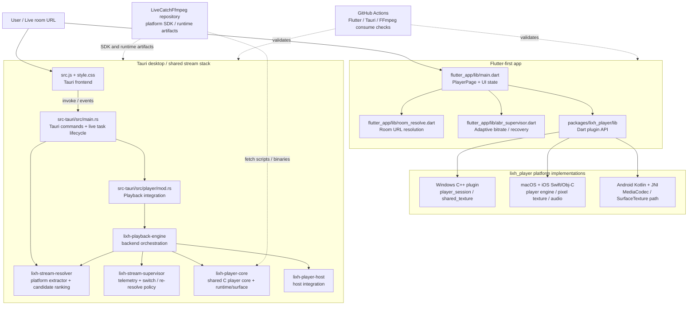
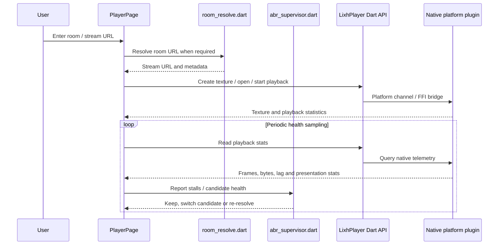
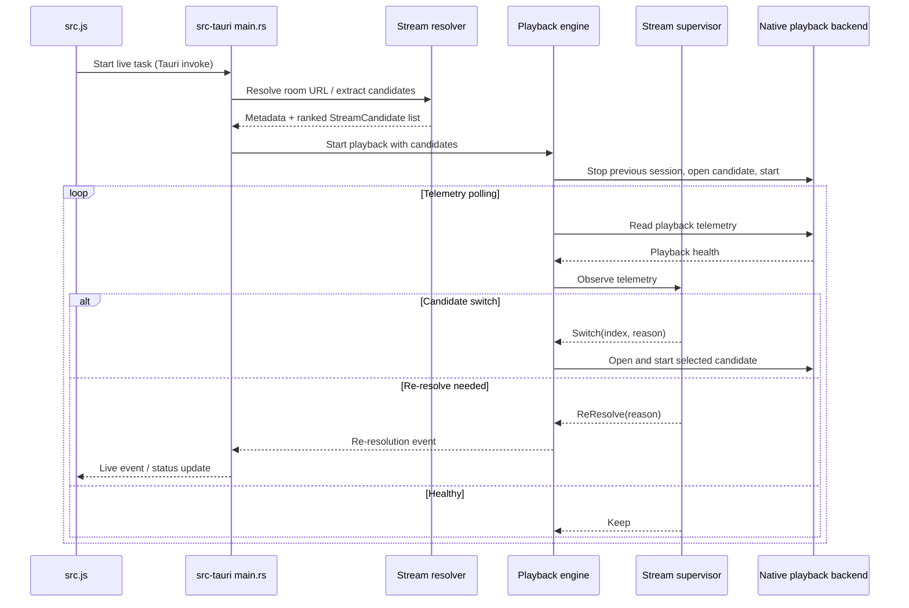

# LiveCatch Graphify Architecture Graph

> Generated from the repository tree and source entry points on 2026-10-10. This is a source-grounded architecture graph, not a runtime-generated call graph. Update it when module boundaries or data flow change.

## System context

## Main runtime flows

### Flutter playback

### Tauri / Rust playback stack

## Component index

| Component | Responsibility | Key source paths |
|---|---|---|
| Flutter UI | Main Flutter application, player lifecycle, telemetry polling and recovery coordination | `flutter_app/lib/main.dart` |
| Flutter room resolution | Resolves room URLs for the Flutter path | `flutter_app/lib/room_resolve.dart` |
| Flutter ABR | Chooses adaptive bitrate recovery actions from playback health | `flutter_app/lib/abr_supervisor.dart` |
| Dart plugin interface | Stable Dart-facing player API and platform abstraction | `packages/lixh_player/lib/` |
| Windows plugin | Windows native playback session, audio and shared-texture presentation | `packages/lixh_player/windows/` |
| Apple plugin | macOS/iOS playback engine, audio output and pixel texture | `packages/lixh_player/macos/`, `packages/lixh_player/ios/` |
| Android plugin | Android plugin bridge and JNI/native playback integration | `packages/lixh_player/android/` |
| Tauri frontend | Desktop UI, command invocation, event consumption and native-window docking | `src.js`, `style.css` |
| Tauri command layer | Live task generations, lifecycle, command handlers and event emission | `src-tauri/src/main.rs`, `src-tauri/src/player/mod.rs` |
| Stream resolver | Platform extraction, metadata mapping, deduplication and candidate ranking | `src-tauri/lixh-stream-stack/lixh-stream-resolver/src/lib.rs` |
| Playback engine | Opens/starts/stops candidates and reacts to supervisor decisions | `src-tauri/lixh-stream-stack/lixh-playback-engine/src/lib.rs` |
| Stream supervisor | Evaluates telemetry and returns keep/switch/re-resolve decisions | `src-tauri/lixh-stream-stack/lixh-stream-supervisor/src/lib.rs` |
| Shared player core | Shared C playback core, runtime and native surface support | `src-tauri/lixh-stream-stack/lixh-player-core/` |
| Player host | Host-side integration boundary for the player stack | `src-tauri/lixh-stream-stack/lixh-player-host/src/lib.rs` |
| FFmpeg delivery | Downloads SDK/runtime artifacts for supported platform targets | `src-tauri/lixh-stream-stack/scripts/` |
| CI verification | Flutter analysis/tests, Tauri platform checks and FFmpeg artifact-consumption checks | `.github/workflows/` |

## Important boundaries and follow-up checks

- The repository currently contains both a Flutter-first application and a Tauri frontend/backend path. Treat them as distinct application entry paths that share concepts and parts of the native playback stack; do not assume every feature is implemented identically in both.
- `packages/lixh_player` is a Flutter plugin with platform-specific implementations. Changes to its Dart interface may require synchronized platform implementations and tests.
- The Rust resolver ranks and deduplicates candidates; the playback engine delegates health decisions to the supervisor. Keep candidate ordering, switch behavior and re-resolution semantics covered by tests.
- FFmpeg SDK/runtime artifacts are fetched from the separate `LiveCatchFfmpeg` repository. Build success depends on the correct platform artifacts being available.
- The diagram describes confirmed module-level relationships. Some lower-level native calls and all runtime paths have not been exhaustively traced in this document.
